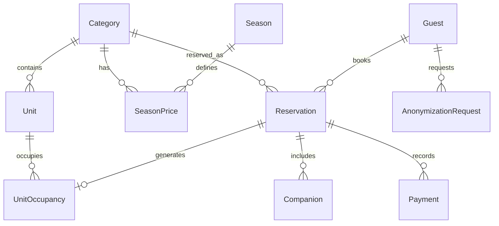

# Data Model: Iguapé Aparts — Motor de Reservas y PMS (001-motor-reservas-pms)

## Diagrama Entidad-Relación Conceptual



---

## Entidades y Atributos

### 1. `AdminUser`
Usuario administrativo para gestión del PMS.
- `id`: `UUID` (PK, default `gen_random_uuid()`)
- `email`: `String(255)` (Unique, lowercase, valid email)
- `password_hash`: `String(255)` (Hash Argon2id)
- `name`: `String(100)`
- `created_at`: `DateTime` (default `now()`)
- `updated_at`: `DateTime` (auto-update)

### 2. `Category`
Tipología o tipo de apart (ej. Classic, Superior, De Luxe).
- `id`: `UUID` (PK)
- `slug`: `String(50)` (Unique, kebab-case, ej. `classic`, `superior`, `de-luxe`)
- `name`: `String(100)` (ej. "Apart Classic")
- `description`: `Text`
- `capacity_adults`: `Int` (≥ 1)
- `capacity_children`: `Int` (≥ 0)
- `max_occupancy`: `Int` (≥ 1, capacidad máxima total adultos + niños)
- `base_price_ars`: `Decimal(12,2)` (> 0)
- `base_price_usd`: `Decimal(12,2)` (> 0)
- `images`: `Json` (Array de strings con rutas de imágenes canónicas)
- `is_active`: `Boolean` (default `true`)
- `display_order`: `Int` (default 0)

### 3. `Unit`
Unidad física individual dentro del complejo (ej. Dpto 1, Dpto 2).
- `id`: `UUID` (PK)
- `category_id`: `UUID` (FK → `Category.id`, ON DELETE RESTRICT)
- `name`: `String(50)` (ej. "Dpto 1 - PB")
- `ical_feed_url`: `String(500)` (Nullable, URL externa de Airbnb/Booking para importar)
- `ical_export_token`: `String(64)` (Unique, token aleatorio seguro de 256 bits para exportar)
- `is_active`: `Boolean` (default `true`)
- `notes`: `Text` (Nullable)

### 4. `Season`
Temporada especial con tarifas diferenciadas y estadía mínima.
- `id`: `UUID` (PK)
- `name`: `String(100)` (ej. "Temporada Alta Verano 2027")
- `start_date`: `Date` (inclusive)
- `end_date`: `Date` (inclusive, `end_date >= start_date`)
- `min_stay_nights`: `Int` (≥ 1, default 1)
- `is_active`: `Boolean` (default `true`)

### 5. `SeasonPrice`
Precio diferenciado por noche para una categoría en una temporada específica.
- `id`: `UUID` (PK)
- `season_id`: `UUID` (FK → `Season.id`, ON DELETE CASCADE)
- `category_id`: `UUID` (FK → `Category.id`, ON DELETE CASCADE)
- `price_ars`: `Decimal(12,2)` (> 0)
- `price_usd`: `Decimal(12,2)` (> 0)
- *Constraint*: `UNIQUE(season_id, category_id)`

### 6. `DiscountRule`
Regla de descuento porcentual por estadía prolongada.
- `id`: `UUID` (PK)
- `min_nights`: `Int` (≥ 2, único entre reglas activas)
- `discount_percent`: `Int` (1 a 99)
- `is_active`: `Boolean` (default `true`)

### 7. `Guest`
Ficha unificada de cliente / huésped en el CRM.
- `id`: `UUID` (PK)
- `doc_type`: `Enum('DNI', 'PASSPORT', 'CI', 'OTHER')`
- `doc_number`: `String(50)` (Normalizado en mayúsculas/alfanumérico)
- `first_name`: `String(100)`
- `last_name`: `String(100)`
- `email`: `String(255)` (Lowercase)
- `phone`: `String(50)` (Normalizado con código de país/área)
- `birth_date`: `Date` (Nullable, sin hora)
- `is_anonymized`: `Boolean` (default `false`)
- `created_at`: `DateTime` (default `now()`)
- `updated_at`: `DateTime` (auto-update)
- *Constraint*: `UNIQUE(doc_type, doc_number)`

### 8. `Reservation`
Reserva de alojamiento principal.
- `id`: `UUID` (PK)
- `code`: `String(10)` (Unique, formato legible alfanumérico ej. `IG-78241X`)
- `category_id`: `UUID` (FK → `Category.id`, ON DELETE RESTRICT)
- `unit_id`: `UUID` (Nullable, FK → `Unit.id`, ON DELETE RESTRICT - asignada o por asignar)
- `guest_id`: `UUID` (FK → `Guest.id`, ON DELETE RESTRICT)
- `check_in`: `Date` (fecha de entrada)
- `check_out`: `Date` (fecha de salida, `check_out > check_in`)
- `adults`: `Int` (≥ 1)
- `children`: `Int` (≥ 0)
- `currency`: `Enum('ARS', 'USD')`
- `subtotal`: `Decimal(12,2)` (Suma de precios por noche)
- `discount_amount`: `Decimal(12,2)` (Monto total descontado)
- `total_price`: `Decimal(12,2)` (subtotal - discount_amount ≥ 0)
- `status`: `Enum('PENDING', 'CONFIRMED', 'CANCELLED', 'FINISHED')` (default `PENDING`)
- `origin`: `Enum('WEB_DIRECT', 'ADMIN_MANUAL', 'ICAL_EXTERNAL')` (default `WEB_DIRECT`)
- `cancellation_reason`: `String(255)` (Nullable, ej. "Cancelada por vencimiento de pago", "Cancelada por huésped")
- `notes`: `Text` (Nullable)
- `payment_method_sent_at`: `DateTime` (Nullable, marca temporal cuando el admin envía datos de pago)
- `created_at`: `DateTime` (default `now()`)
- `updated_at`: `DateTime` (auto-update)

### 9. `Companion`
Acompañante registrado en una reserva.
- `id`: `UUID` (PK)
- `reservation_id`: `UUID` (FK → `Reservation.id`, ON DELETE CASCADE)
- `first_name`: `String(100)`
- `last_name`: `String(100)`
- `doc_type`: `Enum('DNI', 'PASSPORT', 'CI', 'OTHER')` (Nullable)
- `doc_number`: `String(50)` (Nullable)
- `birth_date`: `Date` (Nullable)

### 10. `UnitOccupancy` (CRÍTICA - Integridad Postgres btree_gist)
Registro físico de ocupación por noche en una unidad física, resguardado por Exclusion Constraint.
- `id`: `UUID` (PK)
- `unit_id`: `UUID` (FK → `Unit.id`, ON DELETE CASCADE)
- `reservation_id`: `UUID` (Nullable, FK → `Reservation.id`, ON DELETE CASCADE)
- `type`: `Enum('RESERVATION', 'MANUAL_BLOCK', 'ICAL_BLOCK', 'SOFT_LOCK')`
- `check_in`: `Date`
- `check_out`: `Date`
- `date_range`: `daterange` generado como `daterange(check_in, check_out, '[)')`
- `lock_token`: `String(64)` (Nullable, token de 32 bytes hex para validar el soft lock del usuario)
- `expires_at`: `DateTime` (Nullable, obligatorio para `SOFT_LOCK` = `now() + 15 min`)
- `status`: `Enum('ACTIVE', 'RELEASED')` (default `ACTIVE`)
- `notes`: `String(255)` (Nullable)
- *Exclusion Constraint SQL*:
  ```sql
  ALTER TABLE "UnitOccupancy" ADD CONSTRAINT "exclude_unit_occupancy_overlap"
  EXCLUDE USING gist (
    unit_id WITH =,
    daterange(check_in, check_out, '[)') WITH &&
  ) WHERE (status = 'ACTIVE' AND (expires_at IS NULL OR expires_at > CURRENT_TIMESTAMP));
  ```

### 11. `Payment`
Cobro manual registrado por el administrador.
- `id`: `UUID` (PK)
- `reservation_id`: `UUID` (FK → `Reservation.id`, ON DELETE CASCADE)
- `amount`: `Decimal(12,2)` (> 0)
- `currency`: `Enum('ARS', 'USD')`
- `payment_method`: `Enum('TRANSFER_ARS', 'TRANSFER_USD', 'CASH_ARS', 'CASH_USD', 'MERCADO_PAGO', 'OTHER')`
- `notes`: `Text` (Nullable)
- `receipt_path`: `String(255)` (Nullable, ruta relativa en `storage/receipts/`)
- `receipt_filename`: `String(255)` (Nullable, nombre original del archivo sanitizado)
- `receipt_mime`: `String(100)` (Nullable)
- `receipt_size`: `Int` (Nullable, bytes ≤ 10485760)
- `created_at`: `DateTime` (default `now()`)

### 12. `AnonymizationRequest`
Auditoría y control de pedidos de olvido de datos (Ley 25.326).
- `id`: `UUID` (PK)
- `guest_id`: `UUID` (FK → `Guest.id`, ON DELETE RESTRICT)
- `requested_at`: `DateTime` (default `now()`)
- `deadline_at`: `DateTime` (`requested_at + 30 days`)
- `completed_at`: `DateTime` (Nullable)
- `status`: `Enum('PENDING', 'COMPLETED', 'EXPIRED')` (default `PENDING`)

### 13. `SystemSetting`
Configuraciones globales del PMS (plazos de alerta, retención de comprobantes).
- `key`: `String(50)` (PK)
- `value`: `String(255)`
- `description`: `String(255)`

---

## Máquina de Estados de la Reserva (`Reservation.status`)

```mermaid
stateDiagram-v2
    [*] --> PENDING : Alta reserva web (origen Web Directa)
    PENDING --> CONFIRMED : Administrador registra confirmación
    PENDING --> CANCELLED : Admin cancela o Vence plazo de pago (5 días)
    CONFIRMED --> CANCELLED : Admin cancela reserva
    CONFIRMED --> FINISHED : Fin de la estadía (post check-out)
    CANCELLED --> PENDING : Reactivación (valida cupo disponible; si no hay -> 409)
    CANCELLED --> CONFIRMED : Reactivación directa (valida cupo -> 409)
    FINISHED --> [*]
```
