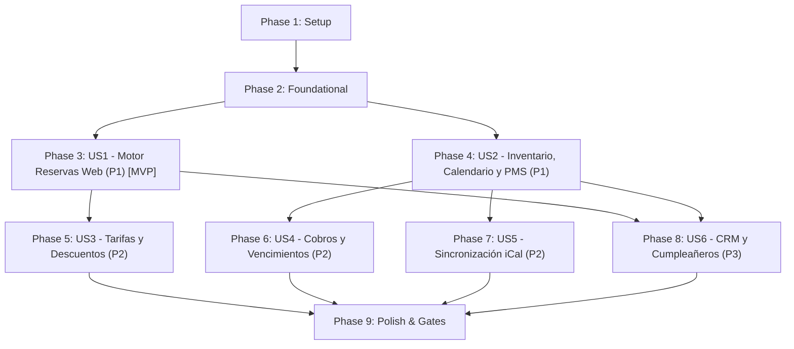

# Tasks: Iguapé Aparts — Motor de Reservas y PMS

**Input**: Design documents from `specs/001-motor-reservas-pms/` (`plan.md`, `spec.md`, `research.md`, `data-model.md`, `contracts/`, `quickstart.md`, `.specify/memory/constitution.md`)

**Prerequisites**: plan.md (required), spec.md (required for user stories), research.md, data-model.md, contracts/

**Tests**: Test tasks are included per **Principle I: Test-First & Red-Green-Refactor (NON-NEGOTIABLE)** of the project constitution (`.specify/memory/constitution.md`), using Vitest 5 for unit/integration tests and Playwright (`workers: 1`) for end-to-end tests.

**Organization**: Tasks are grouped by user story to enable independent implementation, testing, and delivery of each story.

## Format: `- [ ] [TaskID] [P?] [Story?] Description with file path`

- **[P]**: Can run in parallel (different files, no dependencies on incomplete tasks)
- **[Story]**: Which user story this task belongs to (e.g., `[US1]`, `[US2]`, `[US3]`, `[US4]`, `[US5]`, `[US6]`)
- Every task includes the exact file path and clear implementation actions

## Path Conventions

- Single Next.js 16 App Router repository with shared domain modules:
  - App routes & pages: `app/` (Portal público en `app/(public)/`, Panel PMS en `app/adminpanel/`, Route handlers en `app/api/`)
  - Shared domain & business logic: `lib/` (`lib/db/`, `lib/auth/`, `lib/pricing/`, `lib/occupancy/`, `lib/ical/`, `lib/storage/`, `lib/guests/`)
  - Prisma schema & migrations: `prisma/`
  - Automated tests: `tests/` (`tests/unit/`, `tests/integration/`, `tests/contract/`, `tests/e2e/`)
  - Receipts storage: `storage/receipts/` (fuera de `public`, en `.gitignore`)
  - CLI & operational scripts: `scripts/`

---

## Phase 1: Setup (Shared Infrastructure)

**Purpose**: Project initialization, toolchain configuration, and baseline repository setup.

- [x] T001 Initialize Next.js 16 project structure with Node.js 22 LTS, TypeScript 5.5+, React 19, and Tailwind CSS 4 in `package.json`, `tsconfig.json`, `next.config.ts`, `postcss.config.mjs`, and `app/globals.css`
- [x] T002 [P] Configure Vitest 5 testing environment and Playwright e2e configuration with `workers: 1` in `vitest.config.ts` and `playwright.config.ts`
- [x] T003 [P] Configure ESLint 9 and Prettier rules adhering to Next.js 16 conventions and AGENTS.md style guides in `eslint.config.mjs` and `.prettierrc`
- [x] T004 [P] Setup environment variable validation schema for `DATABASE_URL`, `DIRECT_URL`, `SESSION_SECRET`, `CRON_SECRET`, `ADMIN_EMAIL`, `ADMIN_PASSWORD`, and `RECEIPTS_DIR` in `.env.example` and `lib/env.ts`

---

## Phase 2: Foundational (Blocking Prerequisites)

**Purpose**: Core infrastructure, database schema with anti-overbooking exclusion constraint, authentication primitives, and security boundaries that MUST be complete before ANY user story can be implemented.

**⚠️ CRITICAL**: No user story work can begin until this phase is complete and verified.

- [x] T005 Define complete Prisma schema with entities `AdminUser`, `Category`, `Unit`, `Season`, `SeasonPrice`, `DiscountRule`, `Guest`, `Reservation`, `Companion`, `UnitOccupancy`, `Payment`, `AnonymizationRequest`, and `SystemSetting` in `prisma/schema.prisma`
- [x] T006 Create initial migration enabling `btree_gist` extension and defining the PostgreSQL `EXCLUDE USING gist` exclusion constraint `"exclude_unit_occupancy_overlap"` on `UnitOccupancy(unit_id WITH =, daterange(check_in, check_out, '[)') WITH &&)` in `prisma/migrations/0_init/migration.sql`
- [x] T007 [P] Implement Prisma client singleton for application code and direct `pg` connection pool helper for e2e tests in `lib/db/client.ts` and `tests/e2e/db.ts`
- [x] T008 [P] Implement date and timezone helpers enforcing canonical format `dd/MM/yyyy` and `America/Argentina/Buenos_Aires` zone calculations in `lib/utils/date.ts`
- [x] T009 [P] Implement Argon2id password hashing, verification, and encrypted session cookie management in `lib/auth/password.ts` and `lib/auth/session.ts`
- [x] T010 Implement Next.js 16 perimeter routing and security guards for `/adminpanel` in `app/proxy.ts`
- [x] T011 Implement database seeder populating initial admin user, default categories, physical units, and system settings in `prisma/seed.ts`
- [x] T012 [P] Implement admin password reset CLI command script in `scripts/reset-admin-password.ts`

**Checkpoint**: Foundation ready — database schema migrated with exclusion constraint, auth primitives and date utils operational. User story implementation can begin.

---

## Phase 3: User Story 1 - Búsqueda, Cotización y Reserva Directa por el Huésped (Priority: P1) 🎯 MVP

**Goal**: Permitir al visitante consultar fechas, cotizar en ARS o USD con desglose por noche, verificar disponibilidad real, bloquear temporalmente una unidad por 15 minutos exactos (soft lock) y confirmar su reserva web directa en estado Pendiente sin registrarse.

**Independent Test**: Un visitante ingresa a `/`, busca fechas (ej. 15 al 19 del mes próximo) y 2 pasajeros, selecciona una categoría disponible, verifica el temporizador de 15 minutos en `/reservar`, completa datos del titular con modal de WhatsApp, y confirma obteniendo código de reserva `IG-XXXXXX` en estado `PENDING`. 20 peticiones concurrentes para la última unidad producen exactamente 1 confirmada y 19 rechazadas sin sobreventa.

### Tests for User Story 1 🧪
> **NOTE: Write these tests FIRST, ensure they FAIL before implementation**

- [x] T013 [P] [US1] Unit and integration tests for category availability query and nightly pricing breakdown in `tests/unit/availability.test.ts`
- [x] T014 [P] [US1] Integration tests for 15-minute soft lock expiry and concurrent anti-overbooking under 20 workers in `tests/integration/soft-lock.test.ts`
- [x] T015 [P] [US1] Contract tests for public endpoints `GET /api/public/availability`, `POST /api/public/soft-lock`, and `POST /api/public/bookings` in `tests/contract/public-api.test.ts`

### Implementation for User Story 1

- [x] T016 [P] [US1] Implement category filtering and availability service checking `UnitOccupancy` active ranges in `lib/occupancy/availability.ts`
- [x] T017 [P] [US1] Implement nightly pricing calculation service supporting ARS and USD, discounts, and date breakdown in `lib/pricing/calculator.ts`
- [x] T018 [US1] Implement soft lock creation and expiry verification service with Postgres `CURRENT_TIMESTAMP + interval '15 minutes'` and 32-byte hex token in `lib/occupancy/soft-lock.ts`
- [x] T019 [US1] Implement booking creation service creating `Reservation` with origin `WEB_DIRECT`, status `PENDING`, matching or upserting `Guest` by `(doc_type, doc_number)`, and converting soft lock in `lib/bookings/create-booking.ts`
- [x] T020 [US1] Implement route handler `GET /api/public/availability` validating query params (`checkIn`, `checkOut`, `adults`, `children`, `currency`) in `app/api/public/availability/route.ts`
- [x] T021 [US1] Implement route handler `POST /api/public/soft-lock` returning `lockToken`, `unitId`, and `expiresAt` in `app/api/public/soft-lock/route.ts`
- [x] T022 [US1] Implement route handler `POST /api/public/bookings` validating `X-Soft-Lock-Token`, titular age (≥18), document regex, and companion data in `app/api/public/bookings/route.ts`
- [x] T023 [P] [US1] Implement public layout with Iguapé Aparts branding (`#2B3D24`, `#E4E2C5`, `#E6EF73`, DM Serif Display, Source Sans 3, straight corners) in `app/(public)/layout.tsx`
- [x] T024 [US1] Implement public search and category catalog page with date range picker (`dd/MM/yyyy`), adults/children counter, and currency toggle in `app/(public)/page.tsx`
- [x] T025 [US1] Implement reservation step 2 form page with 15-min soft lock countdown timer, titular inputs, companion adder, and WhatsApp confirmation modal in `app/(public)/reservar/page.tsx`
- [x] T026 [US1] E2E test verifying complete public booking journey from search to confirmation code screen in `tests/e2e/public-booking.spec.ts`

**Checkpoint**: User Story 1 complete and independently testable. The public booking engine operates end-to-end without registration and guarantees zero overbooking.

---

## Phase 4: User Story 2 - Gestión de Inventario, Calendario y Ciclo de Reservas (Priority: P1)

**Goal**: Permitir al administrador autenticado gestionar categorías, unidades físicas, visualizar la ocupación en un calendario interactivo respetando la regla inmutable de noche de check-out libre, asignar unidades a reservas y ejecutar transiciones de estado oficiales.

**Independent Test**: Un administrador inicia sesión en `/adminpanel/login`, visualiza reservas en `/adminpanel/calendar` con el día de check-out liberado para nuevo check-in, asigna una unidad física libre a una reserva, y ejecuta transiciones de estado (`PENDING` → `CONFIRMED` → `CANCELLED`), verificando que una reactivación sin cupo retorne HTTP 409.

### Tests for User Story 2 🧪
> **NOTE: Write these tests FIRST, ensure they FAIL before implementation**

- [x] T027 [P] [US2] Unit tests for reservation state machine transitions (`PENDING`, `CONFIRMED`, `CANCELLED`, `FINISHED`) and 409 conflict rules in `tests/unit/reservation-state.test.ts`
- [x] T028 [P] [US2] Contract tests for admin endpoints (`/api/admin/auth/*`, `/api/admin/categories`, `/api/admin/units`, `/api/admin/reservations/*`, `/api/admin/calendar/*`) in `tests/contract/admin-inventory-calendar.test.ts`

### Implementation for User Story 2

- [x] T029 [P] [US2] Implement reservation lifecycle service controlling valid state transitions, cancellation unit release, and reactivation availability checks in `lib/reservations/lifecycle.ts`
- [x] T030 [P] [US2] Implement calendar occupancy query service returning unit-day matrix where check-out date is free for incoming reservations in `lib/occupancy/calendar.ts`
- [x] T031 [US2] Implement admin authentication route handlers (`POST /api/admin/auth/login` with 15-min lockout after 3 failed attempts, `POST /api/admin/auth/logout`, `GET /api/admin/auth/me`) in `app/api/admin/auth/[...route]/route.ts`
- [x] T032 [US2] Implement category and unit CRUD route handlers with deletion guards for future active reservations in `app/api/admin/categories/route.ts` and `app/api/admin/units/route.ts`
- [x] T033 [US2] Implement reservation list, detail, unit assignment, and status update route handlers in `app/api/admin/reservations/route.ts`, `app/api/admin/reservations/[id]/route.ts`, `app/api/admin/reservations/[id]/status/route.ts`, and `app/api/admin/reservations/[id]/assign-unit/route.ts`
- [x] T034 [US2] Implement calendar occupancy matrix and manual block route handlers in `app/api/admin/calendar/route.ts` and `app/api/admin/calendar/blocks/route.ts`
- [x] T035 [P] [US2] Implement admin login page with rate-limiting lock messaging in `app/adminpanel/login/page.tsx`
- [x] T036 [P] [US2] Implement admin panel layout with navigation sidebar, active session banner, and `noindex` metadata headers in `app/adminpanel/layout.tsx`
- [x] T037 [US2] Implement inventory management UI for categories and physical units in `app/adminpanel/categories-units/page.tsx`
- [x] T038 [US2] Implement visual occupancy calendar UI (monthly/weekly grid showing units vs days and free check-out day) in `app/adminpanel/calendar/page.tsx`
- [x] T039 [US2] Implement reservations list and detail management UI with unit assignment and state transition controls in `app/adminpanel/reservations/page.tsx` and `app/adminpanel/reservations/[id]/page.tsx`
- [x] T040 [US2] E2E test for admin authentication, calendar check-out freedom, and reservation lifecycle transitions in `tests/e2e/admin-lifecycle.spec.ts`

**Checkpoint**: User Stories 1 and 2 complete. Front-office direct bookings and back-office PMS management operate in harmony.

---

## Phase 5: User Story 3 - Gestión de Tarifas, Temporadas y Reglas de Descuento (Priority: P2)

**Goal**: Permitir al administrador configurar precios base, temporadas especiales con estadías mínimas y tarifas diferenciadas por categoría, y reglas de descuento por cantidad de noches con prorrateo exacto por noche.

**Independent Test**: El administrador define una temporada con estadía mínima de 4 noches y tarifas diferenciadas, junto a reglas de descuento del 10% (3 noches) y 15% (5 noches). En el portal público, una estadía de 6 noches que cruza días dentro y fuera de temporada prorratea cada noche con su tarifa correspondiente y aplica el 15% (mayor descuento) sobre el total.

### Tests for User Story 3 🧪
> **NOTE: Write these tests FIRST, ensure they FAIL before implementation**

- [x] T041 [P] [US3] Unit tests for multi-season night prorating, minimum stay validation, and non-cumulative discount resolution in `tests/unit/pricing-seasons.test.ts`
- [x] T042 [P] [US3] Contract tests for seasons and discount rules admin endpoints in `tests/contract/admin-seasons.test.ts`

### Implementation for User Story 3

- [x] T043 [P] [US3] Implement seasons and discount rules repository service for CRUD operations and query helpers in `lib/pricing/seasons.ts`
- [x] T044 [US3] Extend pricing calculator to resolve season night rates and enforce season minimum stay when any night touches a season in `lib/pricing/calculator.ts`
- [x] T045 [US3] Implement season and discount rule CRUD route handlers in `app/api/admin/seasons/route.ts` and `app/api/admin/discounts/route.ts`
- [x] T046 [US3] Implement UI for managing seasons, date ranges, minimum stay, and category season prices in `app/adminpanel/seasons-rates/page.tsx`
- [x] T047 [US3] Implement UI for managing discount rules by minimum nights and percentage in `app/adminpanel/seasons-rates/discounts-tab.tsx`
- [x] T048 [US3] E2E test for season rate creation, minimum stay enforcement, and discount application in public search in `tests/e2e/seasons-discounts.spec.ts`

**Checkpoint**: User Stories 1, 2, and 3 complete. Dynamic seasonal pricing and volume discounts calculate accurately.

---

## Phase 6: User Story 4 - Registro de Cobros Manuales y Control de Vencimientos (Priority: P2)

**Goal**: Permitir registrar cobros manuales (ARS o USD) adjuntando comprobantes protegidos en `storage/receipts/`, registrar la marca temporal de contacto, emitir alertas visuales a las 24 horas sin contacto y cancelar automáticamente por vencimiento reservas pendientes tras 5 días.

**Independent Test**: Se crea una reserva `PENDING`; el admin marca "envío de datos de pago"; se registra un cobro manual con archivo PDF adjunto comprobando su descarga autenticada; se simula el paso del tiempo en el endpoint cron verificando cancelación automática de reservas impagas y purga de comprobantes con antigüedad > 3 meses.

### Tests for User Story 4 🧪
> **NOTE: Write these tests FIRST, ensure they FAIL before implementation**

- [x] T049 [P] [US4] Unit tests for payment receipt sanitization, protected storage boundaries, and expiration calculation in `tests/unit/payments.test.ts`
- [x] T050 [P] [US4] Contract tests for payment registration, protected receipt download, and cron maintenance endpoints in `tests/contract/admin-payments.test.ts`

### Implementation for User Story 4

- [x] T051 [P] [US4] Implement secure receipt file storage handler (saving to `RECEIPTS_DIR`, validating MIME types `pdf|jpg|jpeg|png`, size ≤ 10 MB) in `lib/storage/receipts.ts`
- [x] T052 [P] [US4] Implement manual payment registration service recording amount, currency, method, and receipt metadata in `lib/payments/payment-service.ts`
- [x] T053 [US4] Implement reservation expiration service (cancelling pending reservations > 5 days after payment details sent) and receipt purging service (> 3 months) in `lib/cron/maintenance.ts`
- [x] T054 [US4] Implement route handler `POST /api/admin/reservations/[id]/payments` with multipart receipt upload in `app/api/admin/reservations/[id]/payments/route.ts`
- [x] T055 [US4] Implement route handler `GET /api/admin/payments/[paymentId]/receipt` serving binary stream only to authenticated admins in `app/api/admin/payments/[paymentId]/receipt/route.ts`
- [x] T056 [US4] Implement route handler `POST /api/admin/reservations/[id]/mark-contacted` recording `payment_method_sent_at` in `app/api/admin/reservations/[id]/mark-contacted/route.ts`
- [x] T057 [US4] Implement payment registration modal component with receipt upload in `app/adminpanel/reservations/[id]/payment-modal.tsx`
- [x] T058 [US4] Implement admin dashboard visual alert banner for reservations pending contact > 24 hours in `app/adminpanel/page.tsx`
- [x] T059 [US4] E2E test for payment registration, receipt download, contact alerts, and cron expiration in `tests/e2e/admin-payments.spec.ts`

**Checkpoint**: User Stories 1 through 4 complete. Manual payment management and automated expiry keep inventory accurate.

---

## Phase 7: User Story 5 - Sincronización Externa iCal y Prevención de Overbooking (Priority: P2)

**Goal**: Sincronizar bidireccionalmente la ocupación de unidades físicas mediante feeds iCalendar estándar (RFC 5545): exportar ocupación anónima protegida por token de 128+ bits (con 404 ante tokens inválidos) e importar eventos externos de Airbnb y Booking cada 15 minutos o bajo demanda.

**Independent Test**: Consultar `/api/ical/[unitId]/feed.ics?token=INVALID` y recibir HTTP 404; consultar con token válido y recibir `text/calendar` con eventos anónimos sin datos de huéspedes; configurar feed de importación en una unidad, presionar "Sincronizar ahora" y comprobar que las fechas importadas bloqueen la unidad y resten cupo en la web pública.

### Tests for User Story 5 🧪
> **NOTE: Write these tests FIRST, ensure they FAIL before implementation**

- [x] T060 [P] [US5] Unit tests for RFC 5545 iCalendar serialization (anonymous summary, `VALUE=DATE`) and VEVENT parsing in `tests/unit/ical.test.ts`
- [x] T061 [P] [US5] Contract tests for iCal export feed security (404 on invalid token) and manual sync trigger in `tests/contract/ical-api.test.ts`

### Implementation for User Story 5

- [x] T062 [P] [US5] Implement iCalendar feed generator and external feed parser creating `ICAL_BLOCK` in `UnitOccupancy` in `lib/ical/sync.ts`
- [x] T063 [US5] Implement route handler `GET /api/ical/[unitId]/feed.ics` returning RFC 5545 calendar or 404 if token does not match `Unit.ical_export_token` in `app/api/ical/[unitId]/feed.ics/route.ts`
- [x] T064 [US5] Implement route handler `POST /api/admin/units/[id]/sync-ical` for immediate manual unit synchronization in `app/api/admin/units/[id]/sync-ical/route.ts`
- [x] T065 [US5] Integrate iCal sync routine into periodic scheduler route `POST /api/cron/tick` with `CRON_SECRET` authorization header check in `app/api/cron/tick/route.ts`
- [x] T066 [US5] Implement iCal configuration modal with export URL copy button and "Sincronizar ahora" action in `app/adminpanel/categories-units/unit-ical-modal.tsx`
- [x] T067 [US5] E2E test for iCal export 404 security, feed parsing, and external block availability impact in `tests/e2e/ical-sync.spec.ts`

**Checkpoint**: User Stories 1 through 5 complete. Multi-channel calendar synchronization guarantees anti-overbooking across external platforms.

---

## Phase 8: User Story 6 - CRM de Huéspedes, Cumpleañeros y Anonimización (Priority: P3)

**Goal**: Mantener una ficha unificada de clientes identificados por Tipo + Número de Documento con actualización automática de contacto, widget de próximos cumpleañeros a 30 días (manejando 29 de febrero como 28 de febrero en años comunes), y anonimización irreversible conforme a la Ley 25.326.

**Independent Test**: Realizar 2 reservas con el mismo documento y verificar en el CRM la ficha unificada con historial de estadías; verificar que un cliente con cumpleaños en los próximos 30 días aparezca en el widget; registrar solicitud y ejecutar anonimización, verificando que los datos sensibles se reemplacen por cadenas genéricas conservando las estadísticas de reserva.

### Tests for User Story 6 🧪
> **NOTE: Write these tests FIRST, ensure they FAIL before implementation**

- [x] T068 [P] [US6] Unit tests for guest document unicity, birthday window calculation (including Feb 29 non-leap year mapping), and irreversible anonymization in `tests/unit/guest-crm.test.ts`
- [x] T069 [P] [US6] Contract tests for CRM guest directory, upcoming birthdays, and anonymization execution in `tests/contract/admin-guests.test.ts`

### Implementation for User Story 6

- [x] T070 [P] [US6] Implement guest CRM repository service for paginated directory, stay history, and 30-day upcoming birthdays calculation in `lib/guests/crm.ts`
- [x] T071 [P] [US6] Implement irreversible guest and companion personal data anonymization service in `lib/guests/anonymization.ts`
- [x] T072 [US6] Implement route handlers `GET /api/admin/guests` and `GET /api/admin/guests/upcoming-birthdays` in `app/api/admin/guests/route.ts` and `app/api/admin/guests/upcoming-birthdays/route.ts`
- [x] T073 [US6] Implement route handler `POST /api/admin/guests/[id]/anonymize` in `app/api/admin/guests/[id]/anonymize/route.ts`
- [x] T074 [US6] Implement upcoming birthdays dashboard widget component in `app/adminpanel/upcoming-birthdays-widget.tsx`
- [x] T075 [US6] Implement CRM guests directory page with search, stay history drawer, and anonymization button in `app/adminpanel/guests/page.tsx`
- [x] T076 [US6] E2E test for guest CRM consolidation, birthdays widget, and anonymization flow in `tests/e2e/guest-crm.spec.ts`

**Checkpoint**: All user stories (1 through 6) complete and independently verified.

---

## Phase 9: Polish & Cross-Cutting Concerns

**Purpose**: High-concurrency load verification, responsive and accessibility audits, style compliance audits, settings UI, and quickstart end-to-end validation.

- [x] T077 [P] Implement high-concurrency availability and soft lock load testing script under 20 workers (RNF-04) in `scripts/load-availability.ts`
- [x] T078 [P] Implement responsive layout and keyboard accessibility test across 360px to 1920px viewports (RNF-01, AC-102) in `tests/e2e/responsive-keyboard.spec.ts`
- [x] T079 [P] Implement visual style audit test validating brand palette (`#2B3D24`, `#E4E2C5`, `#E6EF73`), fonts, and straight corners (RNF-02) in `tests/e2e/style-audit.spec.ts`
- [x] T080 [P] Implement system settings configuration UI and route handler for operational limits in `app/adminpanel/settings/page.tsx` and `app/api/admin/settings/route.ts`
- [x] T081 Execute full validation against scenarios defined in `specs/001-motor-reservas-pms/quickstart.md`
- [x] T082 Run full verification gates (`npx tsc --noEmit`, `npx eslint .`, `npm test`, `npm run build`, `npx playwright test`)

---

## Dependencies & Execution Order

### Phase Dependencies



- **Setup (Phase 1)**: Can start immediately.
- **Foundational (Phase 2)**: Depends on Phase 1. Blocks ALL user stories.
- **User Story 1 (Phase 3 - P1)**: Depends on Foundational. Serves as the core MVP.
- **User Story 2 (Phase 4 - P1)**: Depends on Foundational. Can run parallel to or immediately following US1.
- **User Story 3 (Phase 5 - P2)**: Enhances pricing calculations from US1.
- **User Story 4 (Phase 6 - P2)**: Extends reservation lifecycle from US2 with payment tracking.
- **User Story 5 (Phase 7 - P2)**: Extends unit occupancy from US2 with RFC 5545 sync.
- **User Story 6 (Phase 8 - P3)**: Consolidates guest data created by US1/US2.
- **Polish (Phase 9)**: Requires all target stories to be implemented.

### Within Each User Story

1. **Tests FIRST**: Write contract, unit, and integration tests; verify they FAIL before implementation.
2. **Domain/Services**: Implement repositories, calculators, and occupancy logic.
3. **Route Handlers / API**: Implement backend endpoints matching contracts.
4. **UI Components & Pages**: Implement visual interfaces adhering strictly to the brand guidelines.
5. **E2E Tests**: Validate full feature slice with Playwright single-worker tests.

---

## Parallel Execution Opportunities

### Within Setup & Foundation
- Setup tasks `T002`, `T003`, and `T004` can run concurrently once `T001` is completed.
- Foundation tasks `T007`, `T008`, `T009`, and `T012` can run concurrently once `T005` and `T006` are established.

### User Story 1 (MVP)
```bash
# Launch test creation in parallel:
Task T013: Unit tests for availability and pricing in tests/unit/availability.test.ts
Task T014: Concurrency soft lock tests in tests/integration/soft-lock.test.ts
Task T015: Contract tests in tests/contract/public-api.test.ts

# Launch core logic and UI in parallel:
Task T016: Availability service in lib/occupancy/availability.ts
Task T017: Pricing calculator in lib/pricing/calculator.ts
Task T023: Public layout in app/(public)/layout.tsx
```

### Across Parallel Teams
Once Phase 2 (Foundational) is completed:
- **Developer / Subagent A**: Phase 3 (User Story 1 - Public Booking Engine)
- **Developer / Subagent B**: Phase 4 (User Story 2 - PMS Inventory & Visual Calendar)
- **Developer / Subagent C**: Phase 5 & 6 (Tariffs & Manual Payments)

---

## Implementation Strategy

### MVP First (Phases 1, 2, and 3)
1. Complete Phase 1 (Setup) and Phase 2 (Foundational with PostgreSQL `btree_gist` exclusion constraint).
2. Complete Phase 3 (User Story 1): Public booking flow with 15-minute soft lock, quotation in ARS/USD, and booking confirmation.
3. **STOP & VALIDATE**: Run `tests/e2e/public-booking.spec.ts` and `scripts/load-availability.ts` to confirm zero overbooking.

### Incremental Delivery
1. Deliver MVP (Public Booking Engine).
2. Add Phase 4 (PMS Inventory & Calendar) → Reception can view stays and manage room assignments.
3. Add Phase 5 (Seasons & Discounts) → Commercial flexibility with multi-season prorating.
4. Add Phase 6 (Manual Payments & Receipt Storage) → Secure payment tracking with automatic expiry.
5. Add Phase 7 (iCal Sync) → Overbooking protection against Booking/Airbnb.
6. Add Phase 8 (CRM & Birthdays) → Guest loyalty and legal data privacy compliance.
7. Execute Phase 9 (Polish & Quality Gates) → Full build verification and load testing.
