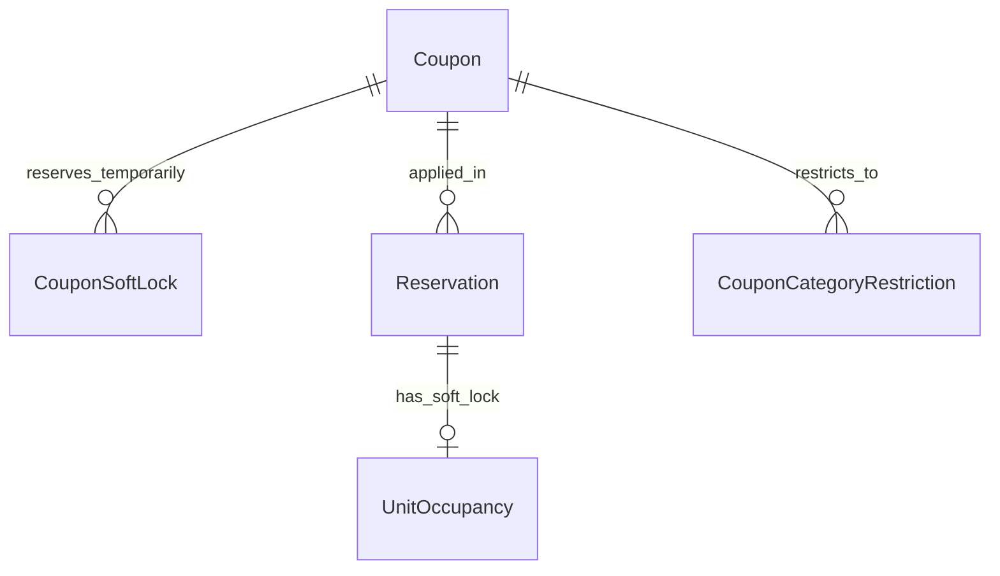

# Data Model: Cupones de Descuento Promocionales (002-cupones-descuento)

## Diagrama Entidad-Relación



---

## Nuevas Entidades y Extensiones de Esquema

### 1. `Coupon`
Representa un cupón promocional configurable por el administrador.
- `id`: `UUID` (PK, default `gen_random_uuid()`)
- `code`: `String(6)` (Unique, exactamente 6 caracteres alfanuméricos en mayúsculas `^[A-Z0-9]{6}$`)
- `discount_type`: `Enum('PERCENTAGE', 'FIXED_AMOUNT')`
- `percentage`: `Int` (Nullable; obligatorio si `discount_type == 'PERCENTAGE'`, rango 1 a 100)
- `fixed_amount_ars`: `Decimal(12,2)` (Nullable; importe fijo en Pesos Argentinos si `discount_type == 'FIXED_AMOUNT'`)
- `fixed_amount_usd`: `Decimal(12,2)` (Nullable; importe fijo en Dólares Estadounidenses si `discount_type == 'FIXED_AMOUNT'`)
- `max_uses`: `Int` (≥ 1, cantidad máxima de canjes totales permitidos)
- `used_count`: `Int` (default 0, contador consolidado de reservas confirmadas)
- `expires_at`: `DateTime` (Fecha y hora límite de canje en horario de Buenos Aires)
- `is_stackable`: `Boolean` (default `false`, indica si se acumula con descuentos de estadía larga)
- `min_nights`: `Int` (default 1, cantidad mínima de noches exigidas)
- `is_active`: `Boolean` (default `true`)
- `notes`: `Text` (Nullable, comentarios internos para el admin)
- `created_at`: `DateTime` (default `now()`)
- `updated_at`: `DateTime` (auto-update)

*Restricciones de validación y base de datos*:
```sql
ALTER TABLE "Coupon" ADD CONSTRAINT "chk_coupon_code_format"
CHECK (code ~ '^[A-Z0-9]{6}$');

ALTER TABLE "Coupon" ADD CONSTRAINT "chk_coupon_discount_values"
CHECK (
  (discount_type = 'PERCENTAGE' AND percentage IS NOT NULL AND percentage BETWEEN 1 AND 100) OR
  (discount_type = 'FIXED_AMOUNT' AND (fixed_amount_ars IS NOT NULL OR fixed_amount_usd IS NOT NULL))
);
```

### 2. `CouponCategoryRestriction`
Restricción opcional de un cupón a una o varias categorías específicas. Si un cupón no tiene registros asociados, es válido para todas las categorías.
- `id`: `UUID` (PK)
- `coupon_id`: `UUID` (FK → `Coupon.id`, ON DELETE CASCADE)
- `category_id`: `UUID` (FK → `Category.id`, ON DELETE CASCADE)
- *Constraint*: `UNIQUE(coupon_id, category_id)`

### 3. `CouponSoftLock`
Retención temporal de 1 uso de un cupón durante el proceso de reserva (15 minutos).
- `id`: `UUID` (PK)
- `coupon_id`: `UUID` (FK → `Coupon.id`, ON DELETE CASCADE)
- `lock_token`: `String(64)` (Token criptográfico de 32 bytes hex que coincide con el soft lock de la unidad)
- `expires_at`: `DateTime` (Momento de expiración = `now() + interval '15 minutes'`)
- `created_at`: `DateTime` (default `now()`)
- *Índice para control de concurrencia*:
  ```sql
  CREATE INDEX "idx_coupon_soft_lock_active"
  ON "CouponSoftLock" (coupon_id)
  WHERE expires_at > CURRENT_TIMESTAMP;
  ```

### 4. Extensión a la Entidad `Reservation` (Auditoría de Canje)
Se agregan los siguientes campos a la tabla `Reservation`:
- `coupon_id`: `UUID` (Nullable, FK → `Coupon.id`, ON DELETE RESTRICT)
- `coupon_code`: `String(6)` (Nullable, código utilizado al momento de reservar)
- `coupon_discount_amount`: `Decimal(12,2)` (default 0.00, importe monetario exacto bonificado por el cupón)

---

## Cálculo de Usos Disponibles en Tiempo Real

Para determinar si un cupón puede ser canjeado o retenido en soft lock:
```sql
SELECT c.*,
  (c.max_uses - c.used_count - COALESCE(sl.active_locks, 0)) AS available_uses
FROM "Coupon" c
LEFT JOIN (
  SELECT coupon_id, COUNT(*) AS active_locks
  FROM "CouponSoftLock"
  WHERE expires_at > CURRENT_TIMESTAMP
  GROUP BY coupon_id
) sl ON sl.coupon_id = c.id
WHERE c.code = :code AND c.is_active = true AND c.expires_at > CURRENT_TIMESTAMP;
```
Si `available_uses <= 0`, el sistema rechaza la aplicación del cupón informando que los cupos se encuentran agotados o en reserva activa por otro usuario.
